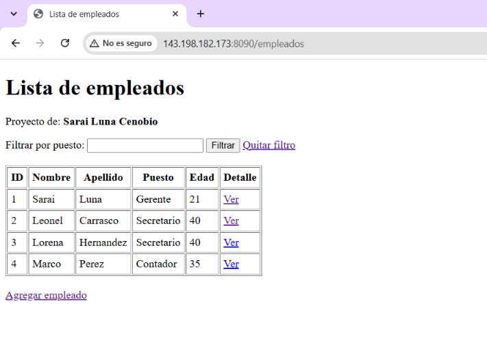
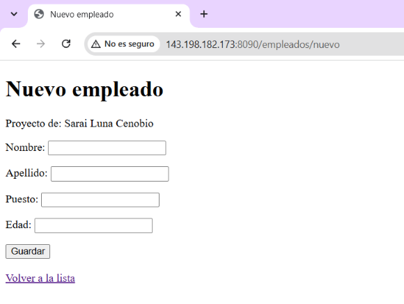
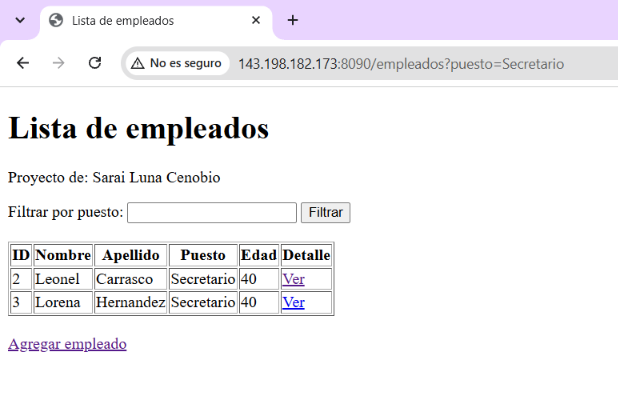
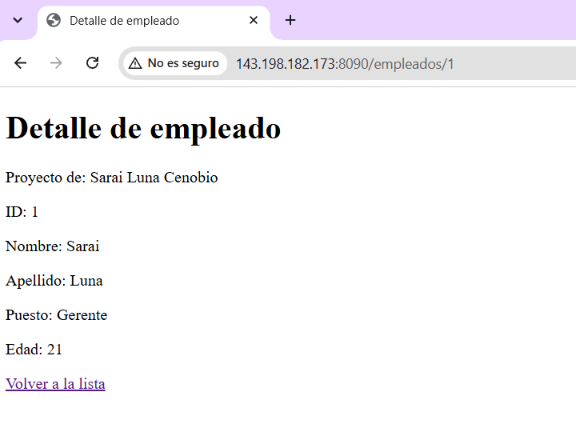
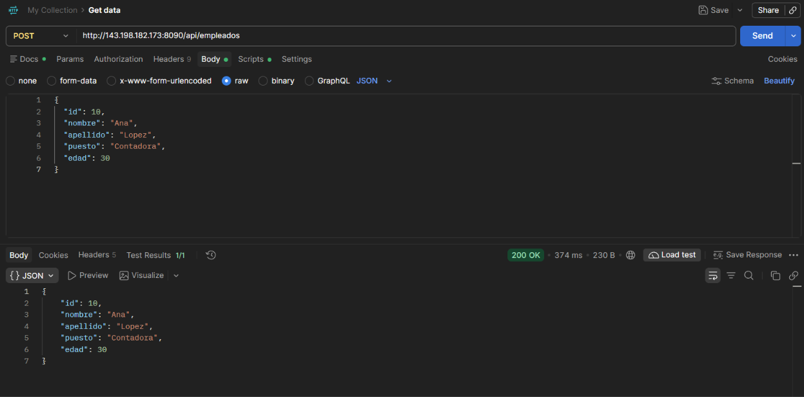

# Actividad 2. Spring MVC - Vistas con Thymeleaf, DTOs y Manejo de Peticiones

* **Actividad:** `slcact2_t4`
* **Autor:** Sarai Luna Cenobio
* **Grupo:** 7SD
* **IP del VPS:** `143.198.182.173`
* **Puerto de ejecución (VPS):** `8090`
* **URL base:** http://143.198.182.173:8090

---

## Descripción

Proyecto en Spring Boot que aplica el patrón MVC con vistas renderizadas por Thymeleaf. Se construyó sobre una copia del proyecto de la Actividad 1 (que se conserva intacto en su propio repositorio). Incluye:

* Una clase DTO (`EmpleadoDTO`) usada en las vistas y en el endpoint POST.
* Un controlador MVC (`EmpleadoViewController`) que devuelve vistas Thymeleaf.
* Un controlador REST (`EmpleadoApiController`) que recibe y devuelve JSON.
* Lectura de una propiedad personalizada con `@Value`.

---

## Estructura del proyecto

```
src/main/java/com/luna/act1/slcact1_t4/
├── controllers/
│   ├── EmpleadoViewController.java   (MVC: devuelve vistas Thymeleaf)
│   ├── EmpleadoApiController.java    (REST: POST que recibe y devuelve JSON)
│   └── ... (controladores de la Actividad 1)
└── models/dto/
    └── EmpleadoDTO.java              (DTO: id, nombre, apellido, puesto, edad)

src/main/resources/
├── application.properties            (incluye config.autor)
├── static/img/                       (capturas del README)
└── templates/empleados/
    ├── lista.html                    (th:each + filtro)
    ├── detalle.html                  (detalle por id)
    └── formulario.html               (formulario con @ModelAttribute)
```

---

## Endpoints

| Método | Ruta | Tipo | Qué demuestra |
|--------|------|------|---------------|
| GET | `/empleados` | Vista Thymeleaf | Lista con `Model` y `th:each` |
| GET | `/empleados?puesto=Secretario` | Vista Thymeleaf | Filtro con `@RequestParam` |
| GET | `/empleados/{id}` | Vista Thymeleaf | Detalle con `@PathVariable` |
| GET | `/empleados/nuevo` | Vista Thymeleaf | Muestra el formulario |
| POST | `/empleados/guardar` | Vista Thymeleaf | Recibe el formulario con `@ModelAttribute` |
| POST | `/api/empleados` | REST (JSON) | Recibe un `EmpleadoDTO` con `@RequestBody` |

---

## Uso de `@Value`

En `application.properties` se definió una propiedad personalizada:

```properties
config.autor = Sarai Luna Cenobio
```

El controlador la lee con `@Value("${config.autor}")` y la envía a las vistas por medio del `Model`. Se muestra en las tres vistas (lista, detalle y formulario) en la línea "Proyecto de: ...".


---

## Evidencias de funcionamiento

Capturas tomadas desde el VPS (`http://143.198.182.173:8090`).

### 1. Lista de empleados (`th:each`)
Ruta: `/empleados`. La tabla se genera recorriendo la lista con `th:each`, y se muestra la propiedad leída con `@Value`.



### 2. Formulario (`@ModelAttribute`)
Ruta: `/empleados/nuevo`. Los datos capturados llegan al controlador mediante `@ModelAttribute` y el empleado se agrega a la lista.



### 3. Filtro con `@RequestParam`
Ruta: `/empleados?puesto=Secretario`. Solo se muestran los empleados con ese puesto.



### 4. Detalle con `@PathVariable`
Ruta: `/empleados/1`. El id se toma de la URL y se muestra el detalle del empleado.



### 5. POST probado en Postman
Ruta: `POST /api/empleados`. Se envía un JSON con la estructura del DTO y el servidor responde con el mismo objeto.

Cuerpo de la petición:

```json
{
  "id": 10,
  "nombre": "Ana",
  "apellido": "Lopez",
  "puesto": "Contadora",
  "edad": 30
}
```



## Enlace

* **Proyecto en el VPS (Actividad 2):** http://143.198.182.173:8090/empleados
