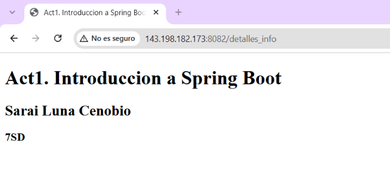
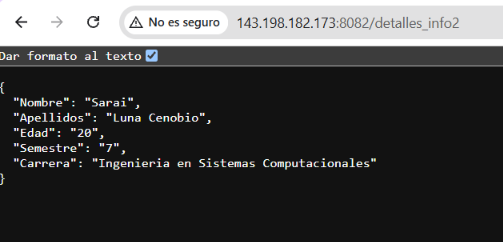
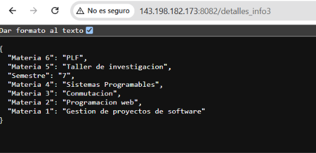

# Actividad 1. Introducción a Spring Boot

---

## 
* **Actividad:** `slcact1_t4`
* **Autor:** Sarai Luna Cenobio
* **Grupo:** 7SD
* **Puerto de ejecución (VPS):** `8082`

---

##  Estructura de Endpoints
La aplicación cuenta con diferentes rutas implementadas para demostrar el uso de controladores tradicionales (`@Controller`) y servicios REST (`@RestController`):

1. **`GET /detalles_info`**
   * *Tipo:* Controlador tradicional (`@Controller`)
   * *Descripción:* Muestra la información general de la actividad y datos del estudiante en formato de texto/vista.

2. **`GET /detalles_info2`**
   * *Tipo:* Servicio REST (`@RestController`)
   * *Descripción:* Retorna un objeto en formato **JSON** con los datos personales e institucionales del estudiante.

3. **`GET /detalles_info3`**
   * *Tipo:* Servicio REST (`@RestController`)
   * *Descripción:* Retorna un objeto en formato **JSON** con el listado de asignaturas cursadas en el semestre.

---

## Despliegue en VPS
El proyecto fue empaquetado y transferido al servidor mediante `scp`, configurando el puerto `8082` en el firewall (`ufw`) y ejecutándolo en segundo plano con `nohup`:

* **IP del VPS:** `143.198.182.173`
* **Puerto:** `8082`

## Evidencias de Funcionamiento

A continuación se muestran las capturas de pantalla de los endpoints en funcionamiento desplegados en el servidor VPS (`http://143.198.182.173:8082`):

### 1. Endpoint: `/detalles_info` (Controlador Tradicional)
Vista o respuesta en texto plano con mis datos generales.
> 

### 2. Endpoint: `/detalles_info2` (RestController - JSON Personal)
Respuesta en formato JSON estructurado con los datos personales.
> 

### 3. Endpoint: `/detalles_info3` (RestController - JSON Materias)
Respuesta en formato JSON con el listado de materias cursadas en el semestre.
> 